# Full-stack architecture

## Scope

The demonstration combines Atlas integration code with pinned Autoware 1.9.0
components. The campus Lanelet map provides route coordinates. NDT uses a
separate synthetic point-cloud map constructed in those coordinates; it does not
localize against the supplied campus PCD.

```mermaid
flowchart LR
  Truth["Pinned simulator\nhidden truth"] --> Scene["Atlas synthetic scene"]
  Route["Atlas route adapter\n+pinned campus map loaders"] --> Scene
  Scene -->|Livox-layout cloud| Convert["Atlas converters"]
  Convert --> Deskew["Pinned distortion corrector"]
  Deskew --> Compact["Atlas compact converter"]
  Compact --> NDT["Pinned NDT"]
  Compact --> Ground["Pinned ground filter"]
  Ground --> Cluster["Pinned Euclidean clustering"]
  Cluster --> Adapter["Atlas measured static-object adapter"]
  Adapter --> Planner["Pinned obstacle-stop planner"]
  Scene -->|raw trajectory| Planner
  NDT --> EKF["Pinned EKF"]
  Scene -->|ideal twist/acceleration| EKF
  Planner --> Smoother["Pinned velocity smoother"]
  Smoother --> Controller["Pinned MPC/PID controller"]
  EKF -->|exclusive controller odometry| Controller
  Controller --> Gate["Pinned command gate"]
  Gate --> Truth
  Base["Atlas localization watchdog"] -->|base authorization| Combined["Atlas combined perception guard"]
  Combined -->|emergency heartbeat authorization| Gate
```

## Component ownership and contracts

| Stage | Implementation | Ownership and notes |
|---|---|---|
| Campus map loading | Autoware map loaders | Pinned; original OSM/PCD/projector files are unchanged. |
| Route selection/adaptation | `atlas_closed_loop_demo/route_adapter` | Atlas; selects a 16 m campus-centerline prefix. |
| Vehicle dynamics | `autoware_simple_planning_simulator` | Pinned; starts disengaged, truth frame is hidden from control. |
| Scene and sensors | `atlas_full_stack_demo/scripts/scene.py` | Atlas; uses truth only to generate ideal body measurements and map-consistent synthetic LiDAR. |
| Raw conversion | `atlas_sensor_kit::LivoxToExtendedComponent` | Atlas converter compatible with the validated layouts. |
| Distortion correction | Autoware distortion corrector component | Pinned implementation; configured without IMU and with co-located virtual LiDAR. |
| Compact conversion | `atlas_sensor_kit::ExtendedToCompactComponent` | Atlas format adapter. |
| NDT | `autoware_ndt_scan_matcher_node` | Pinned; consumes `/atlas_loc/lidar/compact` and the synthetic differential map service. |
| EKF | `autoware_ekf_localizer_node` | Pinned; combines NDT pose and simulated twist. |
| Ground filter | `autoware_ground_filter` | Pinned. Flat virtual mounting/terrain assumptions apply. |
| Clustering | `autoware_euclidean_cluster_object_detector` | Pinned. |
| Object adaptation | `static_objects.py` | Atlas; derives measured bounds from cluster membership and assumes stationary predictions. |
| Stop planning | `autoware_motion_velocity_planner` obstacle-stop module | Pinned. Object branch is used; the parallel point-cloud stop candidate branch is disabled for causal testing. |
| Velocity smoothing | `autoware_velocity_smoother` Analytical mode | Pinned. |
| Control | `autoware_trajectory_follower_node` MPC/PID | Pinned; consumes EKF odometry only. |
| Command gate | `autoware_vehicle_cmd_gate` | Pinned; output drives the simulator only when explicitly engaged and authorized. |
| Base watchdog | `localization_watchdog.py` extending Atlas feedback watchdog | Atlas; monitors odometry, steering, acceleration, trajectory, command and NDT. |
| Combined guard | `perception_guard.py` | Atlas; monitors raw/extended/deskewed/compact/filtered clouds, predicted objects and base authorization. |

## Frames and timestamps

- Global localization frame: `map`.
- Simulated vehicle truth is deliberately identified as hidden truth and is used
  only for sensor generation and independent evaluation.
- Vehicle/control frame: `base_link`.
- LiDAR frame: `synthetic_lidar`, statically co-located with `base_link` in this
  virtual scene. This is a simulation assumption, not physical calibration.
- LiDAR acquisition stamps originate from cached simulator odometry. Conversion,
  ground filtering, clustering, NDT and object adaptation preserve acquisition
  lineage rather than refreshing stale stamps.
- EKF odometry is the exclusive vehicle-state input to MPC, smoother, planner and
  command gate. Simulator-truth odometry is not a fallback.

## Safety behavior

Both Atlas safety monitors retain a 300 ms source-age and callback-receipt-age
limit. They arm only after a continuous healthy interval. A freshness or explicit
authorization violation latches the monitor and removes authorization from the
pinned gate. Stationary operation does not suspend sensor freshness requirements.

The combined monitor depends on the base monitor's heartbeat and armed status.
Consequently a base latch can legitimately cause a later combined
`base_authorization` latch. Latches are not automatically cleared. Evidence must
be preserved before restarting or considering an explicit rearm.

## Synthetic limitations

The scene is planar, instantaneous, co-located, noise-free and lacks ray tracing
or occlusion. The static-object adapter is not general tracking. The actual campus
PCD remains unregistered to this synthetic NDT world. None of these contracts
justify deployment on a physical vehicle.
