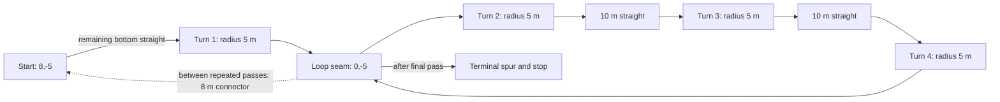

# Synthetic five-lap closed-loop demonstration

This is a development scenario on a separate generated map. It does not change
the stable campus clear-route or obstacle-stop demos and does not start Nav2.

## Route

The centerline is a rounded rectangle with four 90-degree turns, 5 m corner
radii, and 10 m straight sections. The sampled closed road is about 71.384 m.
The mission starts 8 m along its bottom straight and follows 63.375 m of the
loop to the terminal branch, then takes a 12.767 m spur to a distinct goal.
The mission trajectory is 76.142 m for one requested pass. The 8 m seam
separation also keeps the terminal approach outside the 3 m nearest-point
association window around the route start. For repeated passes,
the scene inserts the 8 m road connector between loop prefixes and appends the
terminal spur once. The map road remains closed; the one-pass mission does not
traverse the complete 71.375 m cycle before taking the spur. Five requested
passes plan approximately 361.6 m, depending on connector discretization.



The closed road and terminal-spur lanelets are connected in the
directed vehicle routing graph. The spur is traversed only after the requested
number of loops; it gives the planner a distinct mission goal instead of
ending the LaneletRoute at its start pose.
The corresponding synthetic PCD contains map-aligned road-surface samples and
separated non-planar landmarks. It is deliberately small. Campus OSM/PCD files
are not modified.

## What drives the vehicle

`five_lap_demo.launch.py` uses the existing Lanelet2 route adapter, Autoware
motion-velocity planner/smoother, MPC/PID controller, command gate, simulator,
NDT/EKF localization, and watchdog. The scene publishes one trajectory with
the closed route repeated the requested number of times, the terminal spur
once, and a zero-speed final point. No route/trajectory publication is
counted as a completed lap. The evaluator projects EKF poses onto the closed
route prefix and unwraps progress across the seam; completion additionally
requires reaching the terminal goal and holding below the stop-speed limit.
Ground-truth simulator odometry is recorded only for evaluation. Planned
trajectory endpoint speeds are retained as diagnostics.

The synthetic map cloud is also the fixed landmark set used to produce raw
LiDAR returns: the scene selects points within the configured 12 m range and
transforms them into the LiDAR frame using simulator pose. This provides
consistent map/scan geometry, but it is not ray tracing: there is no occlusion,
material response, scan distortion, or realistic sensor noise. NDT therefore
tests the localization/planning/control interfaces against a controlled
synthetic scene, not field localization performance.

The full-stack scene additionally publishes an ideal motion-derived IMU on
`/atlas_loc/sensors/imu/data`, stamped from simulator odometry, with angular
rate from simulator yaw rate and planar acceleration from velocity change plus
turn kinematics. Its frame is `imu_link` with an identity provisional transform
from `base_link`; orientation is explicitly unavailable. This topic is not
connected to the operational EKF. Its rate follows simulator odometry (not the
standalone sensor simulator's 200 Hz stream). The existing EKF twist input is
still the full-stack simulator's synthetic twist measurement; the simulator
ground-truth pose topic is not an EKF, controller, planner, or NDT input.

## Build and run

Use the development environment and build only the changed packages into a
separate overlay:

```bash
source ~/roam/atlas_autoware_dev_env.sh
colcon --log-base /tmp/atlas_laps_log build --base-paths src \
  --packages-select atlas_map_integration_demo atlas_closed_loop_demo atlas_full_stack_demo \
  --build-base /tmp/atlas_laps_build --install-base /tmp/atlas_laps_install \
  --parallel-workers 1
source /tmp/atlas_laps_install/setup.bash
```

The validation launcher automatically initializes localization and requests
engagement; it runs one trial without RViz and never restarts or teleports the
vehicle between laps. Each output path must be new:

```bash
python3 src/atlas_full_stack_demo/scripts/run_lap_validation.py \
  --laps 1 --output /tmp/atlas_lap_1_$(date -u +%Y%m%dT%H%M%SZ)
python3 src/atlas_full_stack_demo/scripts/run_lap_validation.py \
  --laps 2 --output /tmp/atlas_lap_2_$(date -u +%Y%m%dT%H%M%SZ)
python3 src/atlas_full_stack_demo/scripts/run_lap_validation.py \
  --laps 5 --output /tmp/atlas_lap_5_$(date -u +%Y%m%dT%H%M%SZ)
```

The bounded evaluator writes `validation.json`, `runtime.log`, `route.json`,
and separate JSONL streams for truth (evaluation only), EKF, NDT, raw scans,
trajectory, commands, and scene timing. It reports actual travelled distance,
EKF-projected lap progress, cross-track/heading error, timestamp-matched
localization errors, sensor gaps, and watchdog state. Passing requires the
requested EKF-projected route distance, a three-second terminal stop, no
watchdog latch, and a clean launch shutdown. A timeout or incomplete recording
is a failure, not a partial pass.

For the RViz presentation view after a successful headless validation:

```bash
source ~/roam/atlas_autoware_dev_env.sh
source /tmp/atlas_laps_install/setup.bash
export ROS_LOG_DIR=/tmp/atlas_laps_roslog
ros2 launch atlas_full_stack_demo five_lap_demo.launch.py \
  laps:=5 results_dir:=/tmp/atlas_five_lap_rviz_$(date -u +%Y%m%dT%H%M%SZ) \
  launch_rviz:=true
```

RViz waits ten seconds before opening `config/five_lap.rviz`, which shows the
generated map cloud, Lanelet route, active smoothed trajectory, EKF pose, and
a blue visualization-only 3.1 m by 1.5 m by 0.9 m body marker with an orange
forward arrow. `ego_pose_marker.py` derives its pose and heading only from
`/atlas_loc/ekf/ekf_odom` (`map` / `base_link`); it does not publish TF or read
simulator ground truth. The generic sample-car mesh remains disabled in this
view because it is not an Atlas body model. RViz visibility, marker motion,
and the five-lap run still require a host session with working Fast DDS and a
graphical display; they have not been validated in the restricted development
execution environment.

## Current validation

- Deterministic loop geometry tests: see `scripts/test_five_lap_map.py`.
- Route projection/lap seam tests: see `scripts/test_lap_metrics.py`.
- Scene/IMU/scan regression tests: see `scripts/test_scene.py`.
- Lanelet2 validator command used for the generated map:
  `lanelet2_validate --map_file config/five_lap_loop/five_lap_loop.osm --lat 51.08080935188234 --lon -114.1331143659806`.

The map validator reports zero issues, and the deterministic scene, map, and
lap-metric tests pass. Host trials are not yet accepted:

- Run 09 completed approximately 1.208 EKF-projected passes (86.328 m truth
  distance) but overshot the terminal goal and later latched on stale sensor
  inputs. The planned endpoint had zero speed, but the controller continued
  requesting motion; the gate passed that request.
- Run 10 timed out after 2.371 projected passes (168.889 m) without a watchdog
  latch. The terminal condition was not met.
- Run 11 reached 2.132 projected passes (152.25 m), missed the terminal goal,
  and later latched on stale NDT/sensor inputs. Evaluation-only localization
  RMSE was 0.0662 m and yaw RMSE 0.00822 rad.
- Run 12 stopped early at 0.045 projected passes and 2.974 m truth distance.
  It latched after the raw/NDT stream stopped: the last shared source stamp was
  1793412667.508953088, and the watchdog latched at 1793412667.827094 with
  approximately 0.318 s source age. The last captured scene tick had a 0.003 s
  cached-odometry age and sub-millisecond scan-generation work. No scene timing
  record followed it before shutdown, so the reason the stream stopped is not
  established. Localization RMSE before the latch was 0.0396 m and yaw RMSE
  0.00479 rad.

The start offset was increased to separate the mission start from the terminal
spur, but run 12 ended before testing terminal behavior with that geometry.
Thus the route adjustment is not yet validated as a fix. No trial meets the
one-pass terminal-hold acceptance; two- and five-pass acceptance, RViz motion,
and screenshots remain unvalidated. Do not attempt longer campaigns until the
intermittent scene/sensor publication interruption is understood and a
one-pass terminal hold succeeds.
## Publication interruption investigation (2026-10-31)

The scene and lap validator now record bounded lifecycle and timing evidence.
Scene records include process PID/start, ROS and monotonic tick times, odometry
receipt age, scan publication age, callback timing, executor heartbeat, and
once-per-second CPU/RSS/host-load samples. The lap harness records its launch
process group and the reason/signals used to stop it. These additions are
diagnostic only; they do not change the executor, topics, freshness limits, or
safety behavior.

A 180-second isolated scene stress test passed at
`/tmp/atlas_scene_sensor_stress_20261031_a/`. It used deterministic 50 Hz
synthetic odometry input (not the vehicle simulator), produced 1,795 scans
(9.96 Hz), had a maximum received scan gap of 0.1063 s, and exited normally.
The scene process peak RSS was 68,536 KiB; its sampled CPU fraction peaked at
about 5.83%. This demonstrates sustained scene operation with a steady synthetic
odometry source, but does not test the simulator's odometry delivery or the full
localization/perception load.

The instrumented full-stack diagnostic run is preserved at
`/tmp/atlas_five_lap_1_host_20261031_13/`. The scene continued regular timer
callbacks and raw scan publication through harness shutdown (217 scene timing
records, 208 raw scans, maximum raw receipt gap 0.1123 s). It did not reach
engagement or vehicle motion. Startup logged a timeout while waiting for the
perception component container's `load_node` response; deskewed/compact/object
inputs did not become available, and the existing `manual_start` gate exited
with `Localization/perception authorization unavailable`. The harness then sent
SIGINT to its own launch process group. A localization-watchdog traceback was
logged during teardown, after that signal; it is not evidence that the watchdog
caused the earlier launch failure. The exact cause of the component service
response timeout remains undetermined.

These results do not establish the cause of the earlier publication failures.
Run 09 showed scene timer callbacks continuing while no odometry callbacks arrived
(`stale_odometry` skips), even though evaluation truth continued; the cause of
that callback-delivery gap is unknown. In Run 12, the last captured scene tick
was fast and had fresh odometry, then raw/NDT stopped at the same source stamp
for approximately 0.318 s before the watchdog latched. No later scene record or
exception identifies why publication stopped. The isolated stress test makes a
steady-input scene-generation defect less likely but cannot rule out behavior
under simulator callback delivery or full-stack resource load.

No watchdog or freshness threshold was changed. No one-lap terminal stop has
passed; the later diagnostic run made no progress and is not a one-lap attempt
result. Two- and five-lap acceptance, terminal hold, RViz motion, and screenshots
remain unvalidated. Preserve the failed runs and diagnose the perception
container startup timeout and simulator-to-scene odometry delivery separately
before attempting longer lap campaigns.

## Terminal-path diagnosis and geometry correction (2026-10-31)

Run 30 (`/tmp/atlas_five_lap_1_host_20261031_30/`) did not pass: it reached
1.493 EKF-projected passes and 104.951 m of truth travel, then latched on stale
raw, preprocessing, point-cloud, and predicted-object inputs. Its maximum raw
and NDT header gaps were both 0.281 s; maximum NDT receipt gap was 0.438 s.
At the fault tick the watchdog's source age was 0.330 s, while its own tick
work was 0.000039 s. This does not identify why the upstream streams paused.

The terminal overshoot has a separate, source-and-record-supported cause. The
velocity smoother's nearest-segment search is constrained by a 3 m distance
window and scans the open trajectory from its beginning. On the previous map,
the terminal approach was only 2.821 m from the initial route segment, so the
smoother could associate the vehicle with the first route branch before the
terminal branch. Run 30's planner/controller trace then showed continued
positive commands after the terminal segment instead of a terminal stop.
This is a strong causal explanation for the path wrap, independent of the
watchdog fault.

The generated map now starts the mission 8 m along the bottom straight. A
deterministic geometry regression measures 4.440 m minimum separation from
the terminal branch to the first route segment, outside the existing 3 m
association window. The launch retains Autoware's control and safety settings.
This correction has passed geometry, lap-metric, scene, and watchdog unit
tests and the focused package's one-job CMake configure/build/install. The
installed launch and map assets were checked against the development source.
The correction is not yet live-validated: the restricted execution environment
denied Fast DDS network socket operations, so no new autonomy campaign was
run. Keep the terminal correction provisional until a host-side one-pass run
reaches the distinct spur goal and sustains the required stopped hold.

The prior 180-second scene-only stress test remains evidence only for a steady
synthetic odometry input. It does not explain Run 30's full-stack raw/NDT gaps.
Perception startup response failures are also unresolved. Do not advance to
two or five passes until a host run first demonstrates continuous sensors,
successful perception authorization, and a one-pass terminal hold.
