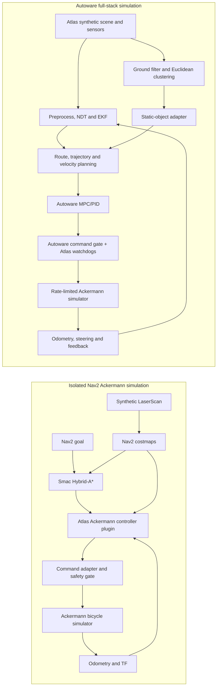

# Mac VM to native Ubuntu handoff

This repository is a development and simulation baseline, not a vehicle-ready
autonomy system. The Mac-hosted Ubuntu ARM64 VM has been useful for ROS
integration, repeatable unit tests, and bounded simulations. It has also shown
intermittent timing/freshness interruptions and software-only RViz rendering
limitations. Native Ubuntu x86_64 validation is the next measurement step, not
a presumed fix.

## What currently runs

There are two isolated navigation/control demonstrations. Neither should be
launched as a second command owner against the other.

### Nav2

The isolated package is `src/atlas_nav2_demo`. It contains a Humble pluginlib
controller, Smac Hybrid-A* planning, Ackermann bicycle-model simulation,
synthetic LaserScan, collision checking, command adapter/safety gate, launch
files, and deterministic tests. Its historical skid-steer fixture is not Atlas
drivetrain validation. The latest checkpoint evidence reports straight 5/5,
curved 5/5, avoidable obstacle 5/5, blocked-route safe abort, full-graph fault
scenarios 6/6, and 70 package tests. Timing acceptance remained open due to an
intermittent watchdog/simulator timer gap. Consult
[`docs/nav2/NAV2_INTEGRATION_STATUS.md`](../nav2/NAV2_INTEGRATION_STATUS.md),
[`docs/nav2/VALIDATION.md`](../nav2/VALIDATION.md), and the native Nav2 guide
before using its runner.

### Autoware

`atlas_full_stack_demo` composes the route and synthetic scene with pinned
Autoware 1.9.0 preprocessing, NDT/EKF localization, ground filtering and
Euclidean clustering, obstacle-stop planning, velocity smoothing, MPC/PID,
and the Autoware command gate. `autoware_control_msgs/msg/Control` already
carries longitudinal velocity/acceleration and tire steering angle; no
Twist-to-steering relay is used. `atlas_vehicle_interface/config/ackermann_vehicle.param.yaml`
holds the shared provisional wheelbase (1.20 m), steering (0.50 rad), and
command limits. Simulator steering rate (0.59 rad/s), acceleration and
deceleration are model assumptions, not measured Atlas data.

Route trials completed individually, but freshness repeatability is not
accepted. The 2026-11-13 perception trace had two post-QoS single-route attempts
reach and hold the goal and one safe predicted-object/base-status freshness
latch. Perception source stamps remain acquisition timestamps. Low measured
adapter compute time does not locate the upstream receipt gap. The full-stack
route uses synthetic scan/map/twist; it does not validate campus PCD
registration. The full-graph E-stop/clear/no-old-route-resume test has passed.
The native runner also invokes existing bounded synthetic source-loss and
NDT-loss full-stack cases. Command loss, frozen odometry, stale predicted
objects, invalid commands, cancellation, command-owner conflict, and
clock-jump cases still lack full-graph runners.

The final Mac sprint kept three bounded smoke captures in
`~/roam/validation_evidence/autoware_ackermann/mac_sprint_20261113T/`. One
initial run used an older map overlay and is a setup failure. A corrected
overlay completed/held one lap (0.0428 m terminal error), but the validator
failed closed because the instrumented simulator option was not enabled. With
step telemetry enabled, the internal rate check passed at 0.5900000000000001
rad/s, then the route safely latched on NDT source age 316.9 ms. The trace
recorded a 134 ms scene timer interval, 34 ms scheduling delay, 110 ms odometry
header age, and an intentionally skipped scan. Linux `MemAvailable` was about
1.17 GiB and memory PSI zero; CPU PSI `some` was about 11%, with process
run-queue waits elevated. These observations support scheduler/delivery delay
as a contributor but do not prove the underlying source. Detailed metrics and
the raw event sequence are in that evidence README.

## First-time native setup

1. Install Ubuntu 22.04 x86_64, ROS 2 Humble, and the pinned Autoware 1.9.0
   dependencies on a development machine. No package auto-installation is done
   by the validation runner.
2. Clone `feature/prd-gap-closure` into a separate development workspace. Do
   not copy the protected stable checkout or its generated build directories.
3. Follow [`docs/autoware/NATIVE_UBUNTU_VALIDATION.md`](../autoware/NATIVE_UBUNTU_VALIDATION.md)
   to identify pinned sources, dependencies, and external map assets.
4. Export `ATLAS_AUTOWARE_ROOT`, `ATLAS_AUTOWARE_SETUP`, `ATLAS_MAP_DIR`,
   `ATLAS_AUTOWARE_OVERLAY`, evidence root, and unused ROS domain range.
5. Run `tools/autoware/run_ackermann_native_validation.sh --check`, then
   `--build`. Resolve missing dependencies explicitly and rerun the check.
6. Start with `--smoke`, then `--faults`, then `--repeatability`. The runner
   is sequential and headless; do not launch another Atlas graph or RViz during
   these captures.

For Nav2, use [`docs/nav2/NATIVE_UBUNTU_VALIDATION.md`](../nav2/NATIVE_UBUNTU_VALIDATION.md)
and `tools/nav2/run_ackermann_native_validation.sh` separately. Never run the
Nav2 and Autoware command graphs simultaneously against one simulator.

## Tests and evidence

Run focused Python suites and the package tests through the built overlay. The
Autoware scripts under `src/atlas_full_stack_demo/scripts/` include lap
validation, E-stop validation, scene tests, scheduler telemetry, and timing
metrics. Use `--trace-perception` only for diagnosis; it adds five best-effort
depth-one subscriptions to intermediate point-cloud topics. The raw-cloud
observer remains active as the sensor-age baseline. ROS source/header ages and monotonic
receipt times are different clock domains and must remain separately labeled.

Existing captures are under `~/roam/validation_evidence/`, especially
`autoware_ackermann/perception_trace_20261113/` and the timing/final-acceptance
folders. Preserve failed captures. Never store validation evidence in the
source tree, and never label synthetic localization or a simulator test as
hardware validation.

## Known risks and what remains

- Perception freshness can fail intermittently even when scene publication and
  adapter processing look normal. Exact publisher-side timing inside the
  pinned Euclidean cluster component and DDS loss/scheduling attribution are
  still unresolved.
- The gate, watchdogs, and simulator are software under the same host
  scheduler. A process that is not scheduled cannot enforce its own timer. A
  physical actuator endpoint must independently time out stale commands and
  use a suitable hardware E-stop design.
- NDT/EKF inputs are synthetic/idealized. Real campus point-cloud localization,
  sensor calibration, clock synchronization, and physical data integrity are
  unverified.
- Native desktop results must be measured; do not attribute the VM issue to
  CPU or QEMU without comparative evidence.
- Atlas dimensions, steering rack conversion, steering-rate/braking dynamics,
  encoder scale, and slip remain unmeasured.
- Pi-to-Jetson acquisition/network contracts, Jetson deployment, HIL, and
  controlled physical tests remain future work.

## Suggested work split for the team

- Native host owner: reproduce route/freshness traces and collect process,
  executor, DDS, and resource metrics.
- Perception owner: add publisher-side monotonic instrumentation to the pinned
  cluster node in an isolated development overlay, without changing source
  timestamps or freshness policy.
- Localization owner: validate NDT/EKF with a real, correctly indexed map and
  calibrated sensor data; resolve queue overflow from measured source rates.
- Safety/vehicle owner: specify actuator-side timeout/E-stop and measure
  geometry, steering and braking only on an approved bench/test setup.
- Integration owner: complete full-graph fault scenarios and keep Nav2 and
  Autoware command ownership mutually exclusive.
