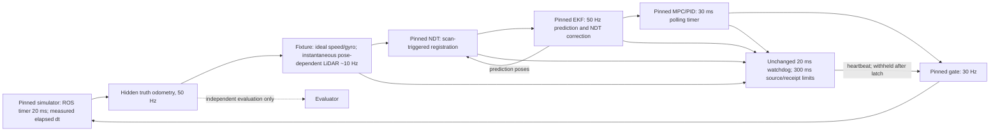

# Nominal localization repeatability: not established

2026-10-22, ROS 2 Humble / ARM64 / 4 GB VM. Investigation bounded to 30 minutes.
This follows the [timing improvements](../simulation_timing/IMPROVEMENTS.md).

**The nominal NDT → EKF → MPC drive remains intermittent.** Two unchanged-condition
baseline attempts produced one pass. Three repeat attempts after a small evaluator
correction produced two passes. All attempts and failures are retained; there is
no retry-until-pass selection. The correction fixes a confirmed measurement
cadence bug, not the unresolved freshness interruptions. No further online
integration or clock changes were attempted.

## Execution and smallest feasible approach



All nodes retain default host-backed ROS time; no `/clock` coordinator is used.
The fixture's wall timer checks ROS time at 20 ms intervals, emitting reference
trajectory, setup messages and scans roughly every 100 ms. Scan timestamps remain
actual simulator acquisition timestamps. Its single executor also serves the
pinned differential-map stub and forwards ideal body speed/yaw-rate measurements.
NDT uses a multi-threaded executor with separate callback groups and one configured
registration worker. EKF and controller execute independently. There is no
end-to-end scan → NDT → EKF → command completion barrier in the driving loop.

The isolated fixed-step runner owns only the vehicle component, a held command
and its output reader. It can advance a clock by exactly 20 ms after each output.
Applying that clock to this whole graph would change pinned contracts:

- controller polling metadata uses host RMW publication time labelled as ROS time;
- PID smooth-stop creates unattached clocks that remain host-backed;
- the watchdog deliberately also measures monotonic receipt freshness;
- fixture wall timers, EKF prediction and asynchronous controller/sensor phases
  would need coordinated execution, not simply a clock flag.

Waiting indefinitely for each stage would defeat the real-time safety contract;
pausing simulated time does not pause its monotonic freshness limit. Wall-paced
steps still cannot guarantee deadlines under host scheduling delays. Resolving
these contracts exceeds a small harness-only change. No general stepping
framework, fake freshness, repeated truth pose seed, estimator substitute or
upstream modification was introduced.

## Confirmed evaluator correction

The old RSS sampler used:

```python
if int(now*2) != int((now-.02)*2):
```

That expression stays true through a 20 ms interval after each half-second
boundary. Every validator iteration in that interval repeated the complete
`/proc` scan. Measured baselines performed **595 and 293 scans**, up to **10 and
11 scans per half-second bin**, respectively. RSS work totalled 0.281 and 0.147 s;
individual measured work took less than 4 ms. This establishes redundant observer
work, not a demonstrated cause of a 330 ms watchdog pause.

`MeasurementCadence` now permits one sample per 0.5 s of evaluator loop time and
skips missed observations without catch-up bursts. The three repeats performed
**108, 56 and 56 scans**. Their differing totals reflect failed-run timeout versus
successful earlier completion. No measurement deadline, watchdog threshold or
runtime node changed. `harness_work.json` records RSS and graph-query durations;
no per-message disk logging was added to control or watchdog callbacks.

Three deterministic unit tests cover the old boundary burst, delayed sampling
without catch-up, exact boundaries and invalid interval. **3/3 PASS**. The
[validator diff](validator_changes.diff) and [source evidence](source_evidence.json)
identify the narrow change and preserved runtime versions.

## Observable timing failures

### Watchdog-side execution/consumption gap

`baseline_1` did not engage. Its saved latch decision was at ROS timestamp
**1792703626.606444**, with watchdog tick gap **332.314 ms**. All six required
inputs were stale in that decision. Simulator and EKF source ages in the saved
watchdog cache were approximately 335 ms; accepted NDT was approximately 395 ms.

The independent recording shows continuous producer progress through that source
time window: maximum observed source gaps were 21.3 ms for simulator truth,
21.4 ms for EKF, 31.2 ms for commands and 120.2 ms for scans/NDT. Latest recorded
source timestamps preceding the latch were only **14.6 ms (truth), 14.7 ms (EKF),
9.0 ms (command), and 35.1 ms (scan/NDT)** old. The first observed latched status
arrived at evaluator-relative 3.905 s. This is inconsistent with a shared 332 ms
halt in all those producers in this occurrence.

The watchdog's own execution gap is directly recorded. Its per-reader RMW delivery
metadata and OS thread scheduling are not captured here, so reader transport,
callback dispatch, blocking within watchdog work and external process preemption
are not conclusively separated. The evidence narrows the problem; it does not
identify the responsible host actor. See [gap analysis](baseline_1/gap_analysis.json)
and [fresh source evidence](baseline_1/fresh_sources_at_latch.json).

The initial `drop_ekf` attempt reproduced the startup pattern, with a 334.738 ms
watchdog tick gap. It never engaged or injected the requested shutdown. It is a
failed fault-test setup, not a passing shutdown demonstration.

### Observed scan/NDT availability gap with timely watchdog execution

`after_1` engaged but later latched on accepted NDT only, at ROS timestamp
**1792703768.8784268**. Tick gap was **20.112 ms**, accepted-NDT source age
**314.471 ms**, and receipt age **288.852 ms**. Other saved source ages were
14–57 ms. The vehicle ultimately stopped about 0.982 m from the goal.

The independent raw-scan and NDT records both have an observed source gap of
**339.925 ms**. NDT reported about 4 ms of execution for the adjacent scans
(4.247 and 4.497 ms), rather than a 340 ms registration. Truth also has an observed
174.783 ms source gap nearby. This points upstream of accepted-pose availability;
it does not prove that no intermediate publication existed at another reader.
Sensor generation, queued truth/timer ordering, middleware delivery and external
execution delays remain unseparated. No scan rate, queue depth, stamping policy
or component clock was changed on that incomplete evidence. See
[the recorded gaps](after_1/gap_analysis.json).

These are two distinct observed failure patterns. The evaluator cadence correction
cannot be represented as their cure. Accurate EKF predictions do not make stale
absolute NDT measurements acceptable; the existing monitor correctly withholds
authorization or brakes when its freshness contract is violated.

## Nominal driving results

Same configured route, map, biased startup seed, covariances, controller parameters,
1 m/s speed cap and default real-time mode. The three post-correction attempts
have identical recorded source hashes. Host scheduling was not controlled.
Successful attempts completed the existing full ten-second stopped hold.

| Attempt | Result | Final goal error, m | NDT max / RMS XY error, m | EKF max / RMS XY error, m |
|---|---|---:|---:|---:|
| Baseline 1 | FAIL, no engagement | 8.000000 | not evaluated | not evaluated |
| Baseline 2 | PASS | 0.054498 | 0.007658 / 0.004542 | 0.009396 / 0.006188 |
| After 1 | FAIL, NDT freshness latch | 0.981618 | 0.004774 / 0.003535 | 0.008728 / 0.003801 |
| After 2 | PASS | 0.105552 | 0.007812 / 0.004175 | 0.009193 / 0.005770 |
| After 3 | PASS | 0.076627 | 0.008047 / 0.004454 | 0.009547 / 0.006036 |

Errors use the unchanged evaluator: post-engagement estimates matched to independent
truth within 25 ms. They describe this ideal synthetic fixture, not physical or
research-recording localization accuracy. A stopped failed run can have small
localization error and still fail the driving demonstration. Full metrics,
resource samples, first watchdog events and provenance checks are in
[summary.json](summary.json) and each run's `validation.json`/CSV files.

Every nominal attempt passes the graph checks: MPC odometry originates exclusively
from pinned EKF; EKF pose measurements originate from pinned NDT; NDT predictions
originate from EKF; scans originate from the evolving-pose fixture; controller,
gate, NDT and EKF do not subscribe to truth odometry. Code inspection confirms no
truth-odometry fallback and only one biased bootstrap pose. Truth is used for
sensor generation, ideal speed/gyro measurements, independent evaluation and the
unchanged watchdog standstill/rearm check, never as controller odometry.

The two passing post-correction attempts observed NDT at 8.82 / 8.90 Hz, EKF at
49.89 / 50.00 Hz and commands at 33.26 / 33.33 Hz. Maximum reported NDT duration
was 99.975 / 16.030 ms; maximum lateral deviation was 3.00 / 3.07 mm. Sampled
process-group RSS was approximately 374.0 / 373.8 MiB; this sums shared pages and
excludes the external evaluator, rather than measuring exact peak physical RAM.
See [passing_timing.json](passing_timing.json). These are observed rates and wall
durations, not deterministic deadlines or CPU-time attribution.

## Safety and preservation validation

The NDT-drop test and both unavailable-startup cases pass. The first EKF-drop
attempt fails before injection, as documented above. The obstacle preservation rerun finished **10/11**: all eight intentional fault
cases passed; off-route driving failed route completion, nominal safety and hold
checks after a trajectory-freshness latch. That latch occurred at decision ROS
stamp 1792704308.1621206, trajectory source age 327.953 ms, receipt age
323.657 ms, and watchdog tick gap 44.003 ms. This separate demo does not use the
modified localization evaluator. Its failure is retained rather than attributed
to the small local correction or concealed by an unrelated fix.

Original control regressions finished **7/7 PASS**, including all six intentional
feedback faults. The unchanged standalone NDT and preprocessing-to-NDT tests also
passed **2/2**. The measured obstacle off-route failure above remains unresolved;
this fresh pass does not preserve an all-green obstacle-suite verdict.

One explicitly bounded isolated EKF-drop follow-up was run after the preservation
suites because the first attempt never injected its fault. It **PASSed**, including
actual engagement, EKF deactivation, expected input staleness, bounded stop and
persistent latch. Both attempts remain in `summary.json`; this is evidence of a
successful injected safety response, not reliable startup. No repeated nominal
runs were added after the predefined three attempts.

## Reproduction and remaining work

Prerequisites are the existing built caches; no installation or upstream build
change is required. Each output directory must be fresh. Run serially:

```bash
cd ~/roam/atlas_autoware
python3 src/atlas_localization_closed_loop_demo/scripts/test_measurement_cadence.py
for attempt in 1 2 3; do
  bash src/atlas_localization_closed_loop_demo/scripts/run_test.sh \
    --scenario nominal --output "/tmp/atlas_nominal_repro_$attempt"
done
```

Preserve all nonzero exits; do not select only a passing attempt. The unchanged
five-scenario suite can be invoked with its existing `run_suite.py --output`
entry point; it does not establish repeated nominal reliability by itself.

The next necessary diagnostic is a bounded trace at the watchdog's actual reader
and timer callback boundaries, plus fixture scan-acquisition/skip timestamps and
OS scheduling evidence at a failure. Passive independent-reader records alone
cannot settle those distinctions. Only a confirmed blocking/callback or sensor
sequencing defect would justify an online change. Full logical-time coordination
requires the larger clock-contract work described above and separate unchanged
wall-time safety tests. The nominal reproducibility objective remains unmet.


Completed at 2026-10-22T21:38:06.184302+00:00.
Stopped within the 30-minute timebox. Nominal reliability and the initiating
scheduling/delivery causes remain unresolved; no speculative online correction
was made.
