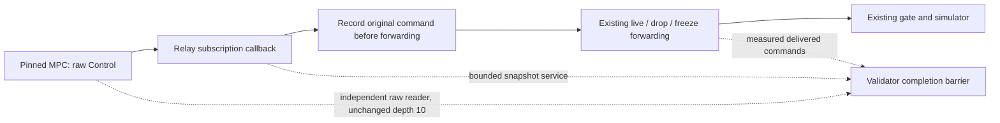

# Simulation scheduling and command observation improvements

This follow-up keeps the production-style watchdog checks and current real-time
launch behavior intact. It addresses test observation independently of timing
safety. The original investigation and clock-domain diagram remain in
[REPORT.md](REPORT.md).

## Reliable observation

The two validators are
`src/atlas_closed_loop_demo/scripts/run_validation.py` and
`src/atlas_obstacle_stopping_demo/scripts/run_validation.py`. Both formerly used
only an independently scheduled depth-10 raw-command subscriber to prove that
every delivered command originated from the controller. A delayed callback can
lose old raw samples even when the relay and output reader received them. A
shutdown drain cannot recover evicted samples. The controlled negative experiment
reproduces 30 delivered / 10 raw observations. That demonstrates the mechanism;
it does not establish every historical failure's initiating cause.

The earlier paced recording barrier works when the test owns the publisher.
Pinned MPC owns the live publisher, so waiting in its actuation path would change
control timing. The integrated version instead records a command synchronously
at the relay's raw subscription callback, **before forwarding**, without waiting
for another node. An explicit service-response barrier transfers that record to
the validator after physical measurement closes. Validation waits for the service
callback to finish and requires every measured delivered payload in the record.
This makes recording precede delivery without pausing the live controller.



`record_commands` defaults to false in both launches; regression validators
explicitly enable it. The journal has a fixed 20,000-command capacity, comfortably
above the bounded scenarios' expected volume. Overflow fails provenance
validation and never blocks actuation. Missing service, missing payload and a
five-second completion deadline also fail explicitly. The journal records actual
raw receipts, including during intentional drop/freeze; it generates no commands.
The existing four-field provenance tuple (source timestamp, steering, target
velocity, acceleration) is retained. This is not a new full-message bitwise audit.
Graph checks still require the exclusive pinned-controller raw source.

`command_recording.json` stores the completion outcome and original receipt rows;
its first column is absolute monotonic receipt time, followed by the four
provenance values. Existing raw CSV observations and frequency calculations remain
independent and unchanged. Missing raw CSV rows are not backfilled or represented
as DDS callbacks. Physical recording closes before the cleanup pause and snapshot
barrier, so service time cannot count toward a successful stop or hold interval.
No extra sleep or enlarged DDS queue is used to establish completion.

## Opt-in fixed-step vehicle mode

The supported entry point reuses the existing tested coordinator and actual
pinned vehicle library:

```bash
# Default: original real-time integration, including a deliberate 500 ms stall.
bash scripts/timing_architecture/run_vehicle_mode.sh
# Opt-in isolated mode: acknowledged logical-clock increments of 20 ms.
bash scripts/timing_architecture/run_vehicle_mode.sh --fixed-step 500
bash scripts/timing_architecture/run_vehicle_mode.sh --fixed-step 0
```

The mode is deliberately component-only: held acceleration/gear, simulator,
coordinator and odometry recorder. Each next clock increment waits for the
matching output stamp. No controller, localization estimator or watchdog is
silently converted to simulated time. The full driving launches retain their
real-time default. This formalizes the validated fixed-step probe as a reusable
opt-in test mode; it does not change vehicle equations or upstream code.

A whole-loop launch flag would not be safe within this change. The actual pinned
polling helper labels host RMW publication timestamps as ROS time, and PID
smooth-stop creates unattached clocks that remain host-backed. The existing
monotonic freshness checks must also keep their safety meaning. The proof repeats
both clock incompatibility observations. Resolving them and coordinating all
controller/localization phases is the larger architecture task described in
REPORT.md, not part of this patch.

## Validation

Fresh proof artifacts: [improvements_proof](improvements_proof/).
Fresh serial integration artifacts: [improvements_runs](improvements_runs/).

The previous retained baselines were obstacle 10/11 and original campus control
3/7. The latter seven were reported during localization integration but are the
original campus nominal plus six feedback-fault regressions, not seven NDT/EKF
scenarios. The actual NDT/EKF suite contains five scenarios; it is run separately
here as well, with results kept distinct.

Reproduction, using fresh output directories and the existing built caches:

```bash
bash scripts/timing_architecture/run_proof.sh /tmp/atlas_timing_followup_proof
python3 src/atlas_obstacle_stopping_demo/scripts/run_suite.py --results-root /tmp/atlas_timing_obstacle
bash src/atlas_localization_closed_loop_demo/scripts/run_regressions.sh /tmp/atlas_timing_control
python3 src/atlas_localization_closed_loop_demo/scripts/run_suite.py --output /tmp/atlas_timing_localization
```

Run these serially; preserve nonzero exits and continue to the next suite to
collect the complete result. Refresh the Atlas closed-loop and obstacle packages
with their existing `scripts/build_demo.sh` entry points after source changes.
The test harness does not alter pinned dependency sources.

## Results and scope

- Obstacle-stop suite: **11/11 PASS**, versus the retained 10/11 baseline.
  Its existing review tool passed 264 recorded checks. All eight injected fault
  scenarios retain their required safety responses. The first base-watchdog
  latch names the selected feedback input in each of the six feedback faults;
  both obstacle-staleness cases latch on `pointcloud`.
- Standalone pinned NDT and preprocessing-to-NDT: **2/2 PASS**.
- Original campus control regressions: **7/7 PASS**, versus retained 3/7.
  All six intentional feedback faults pass their existing safety assertions.
- Separate NDT/EKF localization-driven scenarios: **4/5 PASS**. `drop_ndt`,
  `drop_ekf`, `no_ndt` and `no_ekf` pass. `nominal` fails; no nominal localization
  driving success is claimed.
- Every command-recording barrier in the obstacle/control runs passes: **18/18**.
- Deterministic journal regression coverage: **5/5 PASS**, covering 30/30 command
  retention with the raw reader withheld, missing provenance, capacity overflow,
  unchanged drop/freeze forwarding and an unavailable-service deadline.
- Existing paced observation test: **1/1 PASS**, 30/30 retained. Existing negative
  experiment reproduces 30 delivered / 10 observed. Clock decision tests:
  **4/4 PASS**. Existing localization watchdog and fault-observation decisions:
  **4/4 + 4/4 PASS**. An initial standalone watchdog-test invocation omitted the
  demo overlay and failed package lookup; sourcing the documented overlay fixes
  that invocation. Both logs are preserved; no test code was changed for it.
- The new public vehicle-mode entry point passes in default real-time mode and
  both fixed-step stall cases; final controlled states are identical.

The numerical fixed-step comparison repeated successfully: both zero-stall and
500 ms-stall cases finished with x = 0.016000000238418577 m and vx =
0.0800000011920929 m/s, with 22 outputs. The first resumed controlled increment
was 0.020 s and approximately 0.004 m/s. Real-time integration instead advanced
0.501524212 s and approximately 0.100304 m/s after the deliberate 500 ms stall.
This is evidence of isolated numerical repeatability, not whole-loop determinism.

A fresh nominal pass does not prove the journal corrected historical watchdog
latches: the journal addresses provenance observation and the fresh run has a
different scheduling history. The host actor causing historical interruptions
remains unknown. No transport-delay versus executor-delay claim is inferred from
journal receipts alone; the earlier passive metadata probe remains the evidence
for that distinction.


### Actual recovered command observation

The fresh campus nominal run has one delivered payload absent from its independent
raw-reader CSV. It was received at validator-relative **6.235701386 s**, with source
stamp **1792702113.2520154**. The journal contains the identical provenance tuple,
recorded at relay monotonic **26449.118003962 s** before forwarding. This is a
real missing independent observation recovered by the integrated barrier, not a
synthetic replacement or a delayed final shutdown callback. Raw CSV evidence is
kept intact. The former raw-CSV-only provenance predicate would fail on these
same datasets, whereas the completed journal barrier passes.

See [recovered_observation.json](improvements_runs/recovered_observation.json)
and [results_summary.json](improvements_runs/results_summary.json). Across the
18 runs every measured delivered payload is represented in its journal. This
proves that bounded provenance-observation contract; it does not prove lossless
transport to every ROS reader or identify the exact loss mechanism in the
independent reader.

### Remaining localization timing failure

In the new NDT/EKF nominal run, the saved latch decision timestamp is
**1792702448.9820087**. The first received status already contains the latch at
validator-relative **3.898103548 s**. At the decision, watchdog tick gap was
**0.341174696 s**. Source ages were **0.333795–0.398232 s**, and monotonic receipt
ages **0.332559–0.384521 s**, across odometry, steering, acceleration, trajectory,
command and accepted NDT. These exceed the unchanged 0.300 s freshness limit.
Later status can report fresh inputs while retaining the intentional latch.

The vehicle never engages or moves: final goal distance remains 8 m. The run
nevertheless records 481 NDT estimates, with maximum reported NDT execution time
27.343 ms. That algorithm duration excludes queueing and end-to-end scheduling;
it cannot explain away the observed freshness failure. Accuracy metrics are null
because no engaged evaluation interval exists, not evidence of accurate driving.

The watchdog's measured execution gap is observable. Transport delay versus
pending subscription-callback delay at its reader is not measured in this run,
and the external host/resource actor is unproven. The command journal is absent
from this separate direct-controller localization launch. No change in this
follow-up resolves this whole-loop timing problem. The four localization fault
cases still stop or withhold engagement as expected; `drop_ekf` also observes
stale accepted NDT through the existing prediction dependency, without hiding
that behind fresh EKF publication timestamps.

The remaining architectural blockers are the pinned polling timestamp-domain
mismatch, unattached PID smooth-stop clocks and a whole-graph consumption protocol
that preserves independent wall-time safety checks. Existing driving tests remain
real-time deadline tests. Their fresh passes are not a guarantee against future
intermittent failures or proof of full-system determinism. No safety threshold,
watchdog implementation, original bag or pinned upstream source was changed.
Pinned revisions, preserved source hashes and installed relay/helper agreement
are recorded in [source_evidence.json](improvements_proof/source_evidence.json).
