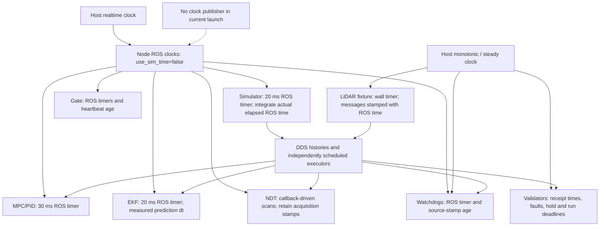

# Simulation timing architecture audit and bounded proof

2026-10-22. Investigation started 20:11 UTC, with an approximately 25-minute
limit. **The architecture contributes to scheduling-sensitive results; this is
proved at component level. The initiating cause of all historical watchdog
failures is not established, and the complete driving loops are not corrected.**

The existing suites were not rerun. Their last recorded outcomes remain obstacle
stop 10/11, original control regressions 3/7, and the localization milestone
incomplete. An earlier 8 m localization drive does not override later failures.
No pinned source, existing runtime/validator implementation, watchdog predicate, safety threshold,
research recording, hardware configuration or installed system package changed.
New work is isolated under `scripts/timing_architecture` and this evidence folder.

## Clock domains and scheduling



Runtime [parameter audit](proof/runtime/audit.json) queried all eight localization
launch nodes: simulator, controller, EKF, NDT, smoother, gate, sensor fixture and
watchdog had **`use_sim_time=false`**, and `/clock` had **zero publishers**. The
simulator stayed unengaged; observed speed was zero. This is a parameter/QoS audit,
not a driving pass. Original campus/obstacle launch/configuration and runners
likewise contain no `/clock` publisher or `use_sim_time` override: they use default
system-backed ROS time. Their configuration was inspected rather than rerun.

The ROS nodes are consistently in the default clock mode; there is no evidence
that an accidental mix of `use_sim_time=true/false` caused the archived failures.
However, logical timestamp time and independent monotonic safety/observation time
remain different contracts even when both normally track real seconds.

| Participant | Scheduling and time contract | Consequence of delay |
|---|---|---|
| Pinned simulator | `rclcpp::create_timer(get_clock(),20 ms)` in the existing single-thread component container. `DeltaTime::get_dt(now)` subtracts previous node-clock time, with no fixed-step substitution. | One delayed callback integrates a large elapsed interval under the last applied input. Output messages call `now()` individually after integration. |
| Pinned controller | SingleThreadedExecutor, 30 ms ROS timer. Depth-1 polling subscriptions are in a non-executor callback group; timer code explicitly takes data. MPC uses configured 30 ms period; PID measures ROS dt then clamps to 15–60 ms. | Model and controller effective steps can diverge substantially after an overrun. Polling returns cached latest data if no new take succeeds. No global producer/consumer ordering barrier exists. |
| Pinned gate | SingleThreadedExecutor, two ROS timers at configured 30 Hz. Heartbeat receipt and expiry use node ROS time; configured timeout remains 0.3 s. | Timer/callback order and delayed execution affect the time at which braking is generated. Freezing ROS time also freezes this heartbeat-expiry domain. |
| Pinned EKF | SingleThreadedExecutor, ROS control timer at 50 Hz and diagnostics at 10 Hz. Prediction dt is measured from node time, capped at 10 s; output is stamped current node time. Pose/twist subscription queues have depth 1. | Scheduling changes prediction steps. Freshly stamped prediction output does not prove recent accepted NDT input. |
| Pinned NDT | MultiThreadedExecutor; separate mutually exclusive sensor, prediction and map timer groups. Scan depth 1 best effort; prediction depth 10. Map timer uses ROS time, 1 Hz. Output preserves scan stamp; input-age checks use node ROS time. Processing-time measurements use `system_clock`. | Valid matches can arrive with old acquisition stamps. Solver execution time excludes upstream queue/dispatch delays and is not an end-to-end age bound. Concurrency is not deterministic execution order. |
| Pinned path generator / smoother | Path generator uses a ROS timer. Smoother is trajectory-callback driven, polling ego state at callback execution, retaining trajectory headers. | Trajectory publication and ego input availability depend on independent scheduling. |
| Atlas feedback and obstacle monitors | Python `create_timer` uses node ROS clock, 20 ms. Both source age in ROS time **and** receipt age using `time.monotonic()` must be <0.3 s. Arming/standstill/rearm stability uses monotonic time. Single-thread `spin_once`. | Delayed consumption can legitimately latch even with finite/correct payloads. Pausing `/clock` alone does not prevent monotonic receipt expiry. |
| Atlas relay / obstacle source | Python ROS timers (20/50 ms). Relay forwards original timestamps; release delay and visualization throttling use monotonic time. | Another independently scheduled hop; restamping would conceal latency and is not proposed. |
| Atlas LiDAR fixture | C++ `create_wall_timer(20 ms)` uses a steady clock. Up-to-10-Hz scan/reference generation gates on ROS `now()`; scan stamps come from simulator truth. | Simply enabling simulated time leaves this timer running on host time, while its ROS-time gates may stop. It needs an explicit test-clock contract for full controlled-time use. |
| Route visualization adapter | C++ steady wall timer at 50 ms; ROS message stamps. | Mostly visualization load; its wall timer also survives a paused ROS clock. No causal attribution to a latch was proved. |
| Validators | Single-thread Python `spin_once`; monotonic run/fault/recovery/receipt time; message stamps retained. Terminal hold checks require both advancing receipt and source time. Graph queries and recording share the executor thread. | They assume real-time progress. Running the same code slower in virtual time changes fault timing and hold/timeout meaning; a new test-clock driver cannot silently reuse those wall-time verdicts. |

The simulator is **elapsed-time**, not “one 20 ms dynamics update per callback.”
A 20 ms timer period is a scheduling request, not a fixed integration step or a
CPU deadline guarantee. ROS timers generally do not replay all missed dynamics
steps at their nominal period. The unchanged production-style freshness policy
correctly rejects data consumed after its age bound; a correct numerical payload
is insufficient evidence of freshness.

## QoS and observation contract

Simulator odometry and gate/controller paths commonly use depth 1. Controller
inputs use the pinned `InterProcessPollingSubscriber` with default latest-data
policy/depth 1, rather than ordinary executor-dispatched callbacks. The recorder
and watchdog ordinary subscriptions use depth 10 in the existing suites (the
new localization evaluator uses depth 100 for recorded reliable topics). NDT
scans intentionally use best-effort depth 1.

The runtime RMW endpoint report returned history depth **0** for these endpoints;
that does **not** replace the declared source depths above. Reliability/durability
were visible, while history depth should be taken from construction/configuration.
Reliable delivery does not promise unlimited sample retention or that a callback
has executed. At approximately 33 Hz, a depth-10 recorder has only roughly 300 ms
of history. A delayed raw observer can miss provenance samples even when the relay
and delivered reader received the command.

Historical evidence already distinguishes these effects: an observer measured
0.221 ms publication-to-receive and 31.654 ms receive-to-callback delay on a
recovered trajectory, but its own timings cannot identify the watchdog reader's
queue contents. The archived latch source/receipt/tick gaps establish violations,
not the exact host actor, middleware loss mechanism or callback order.

## Targeted before/after proof — unchanged pinned simulator

The new C++ coordinator loads the **actual registered pinned simulator component**
from the existing library. It reuses the existing provisional geometry and geared
model, with constant 0.2 m/s² input in a private ROS domain. There is no replacement
dynamics code. This is a simulator component test: no controller, NDT/EKF, gate or
online watchdog is removed from an existing driving test to obtain a pass.

The coordinator deliberately stops its executor for 500 ms. In controlled mode
it publishes `/atlas_timing/clock`, waits for output carrying the requested time,
and advances the clock only after that output barrier. It never rewrites received
state timestamps and never caps the pinned simulator's elapsed dt.

[Results](proof/step_results.json):

| Experiment | Requested wall stall | Next state timestamp interval | Velocity increment |
|---|---:|---:|---:|
| Current system-backed ROS time | 500 ms | 502.139 ms | 0.100428 m/s |
| Controlled ROS time + output barrier | 500 ms | 20.000 ms | 0.004000 m/s |
| Same controlled steps, no stall | 0 ms | 20.000 ms | 0.004000 m/s |

Both controlled runs ended at exactly the same recorded x and velocity:
**0.016000000238418577 m**, **0.0800000011920929 m/s**, with 22 recorded outputs
including initialization. This establishes invariance to the deliberate wall
pause for this constant-input component experiment. It is not a closed-loop
route result or proof of arbitrary callback-order determinism.

The wall-time run is not an upstream simulator defect: it demonstrates its actual
intended elapsed-time contract. That contract makes the current synthetic tests
sensitive to scheduling and explains why blindly treating each callback as a
fixed simulation step is unsound. Which external actor caused a historical pause
remains unresolved.

### Watchdog contracts remain conservative

Four [deterministic tests](proof/clock_tests.log) call the actual unchanged
watchdog predicate with controlled clocks and establish:

1. A fresh callback carrying an old source stamp remains stale.
2. A 500 ms monotonic pause expires receipt freshness even if ROS time is frozen.
3. Evaluating the timer before a pending subscription callback sees the old
   application state; running that callback updates the state. This demonstrates
   the mechanism, not the historical queue's exact contents.
4. Advancing logical source age past 300 ms must still expire freshness.

Thus **`use_sim_time=true` is not a watchdog fix**. Replacing monotonic receipt time
with ROS time in an existing/hardware-facing monitor would change its safety
contract and was not done.

### Recorder correction proof, without larger queues

The existing controlled backlog experiment again produced **30 delivered / 10
raw recorded** at depth 10 ([before](proof/observation_before.log)). The new
[observation barrier](proof/observation_after.log) waits until both delivery and
raw recording complete before releasing the next command: **30 delivered / 30
recorded**, with the **same depth 10** and actual Atlas relay forwarding method.
The test validates message payload equality too.

This is a proof for a controlled producer/recorder protocol, not a fix retrofitted
to the current independently running controller/validators. A middleware ACK alone
is not this barrier: it does not prove application callback/recording completion.
Existing provenance assertions remain enabled and untouched.

## Additional controlled-time blocker: middleware timestamps

Inspection and a [targeted compiled probe](proof/polling_clock.log) found a concrete
clock-domain incompatibility in the pinned polling helper used by the controller:

- `Latest::take_data()` stores RMW `source_timestamp` as an `rclcpp::Time` labelled
  `RCL_ROS_TIME`.
- That metadata is host publication time, independent of the application header
  or `/clock` value in this runtime.
- `Controller::check_cyclic_message_timeout` subtracts this timestamp from node
  ROS `now()` and compares only `age > 0.9`.

The actual shared polling template was tested with a message stamped at logical
1 s, then logical time advanced to 2 s without another message. Header age was
**1 s**; polling-metadata age was about **−1.7927 billion seconds**. The existing
comparison therefore did **not** signal the cyclic timeout. The probe reproduces
that template plus the controller's comparison, not an entire controller drive.

This does not explain the archived default-clock failures: those nodes use
system-backed ROS time. It does block any assertion that the full pinned stack
is automatically time-correct after enabling `/clock`. An epoch-aligned starting
clock also diverges from host publication time when virtual time pauses or runs
at another speed. Independent header-age monitors remain necessary; this finding
must not be silently hidden or “fixed” by weakening checks. Upstream was not
modified, and no controller diagnostics were disabled.

The PID smooth-stop helper has another source-level clock split:
`SmoothStop::init`, `calcTimeToStop` and `calculate` construct temporary
`rclcpp::Clock{RCL_ROS_TIME}` objects rather than using the node's attached clock
(`smooth_stop.cpp`, lines 29, 77, 154 and 160). A standalone ROS clock is not
automatically attached to `/clock`. The compiled probe also confirms that this
clock construction remains host-time backed while the node clock is at logical
2 s. Thus node-level `use_sim_time` alone does not convert the controller's
whole stopping-time contract. The helper's end-to-end behavior in a controlled
closed loop was not tested; no upstream change was made.

## Minimal correction and next options

The smallest defensible correction implemented here is a **separate test-only,
clock-stepped component coordinator with explicit output/recording barriers**.
It changes scheduling of synthetic test work, not physical safety behavior. It
proves a useful building block without changing existing demos or inventing an
end-to-end fixed-step release. The existing integration tests remain real-time
safety/performance tests and retain their failures.

A complete deterministic NDT/EKF/MPC loop is larger than a launch flag. Rough
remaining engineering estimates, not promises:

| Option | Estimated effort | Scope/tradeoff |
|---|---|---|
| Keep real-time driving/safety tests; add deterministic component/observation tests | Implemented proof; roughly half a day to expand/polish cases | Lowest disruption. Separates numerical contracts from host deadline qualification. Does not guarantee this VM's real-time loop. |
| Bounded wall-paced integration with overrun and reader-loss diagnostics | About 0.5–1 day | Fail explicitly on scheduling/observation overruns; retain conservative wall freshness. More diagnostic and reproducible verdicts, not deterministic motion under arbitrary stalls. |
| Fully coordinated logical-time closed-loop functional test | About 2–4 days plus validation | Must coordinate 20/30/100 ms phases, sensor/map work, EKF/NDT prediction feedback and recorder consumption; audit all wall timers; resolve polling diagnostic and standalone smooth-stop clock contracts. Preserve separate unchanged wall-time safety tests and an external wall-time test deadline. |

Do not implement the third option as a broad rewrite in this investigation.
Its logical-time functional results cannot be represented as passing hardware
wall-time safety deadlines. The polling diagnostic and monotonic monitor domains
require explicit treatment, rather than a blanket `use_sim_time` override.

## Reproduction and outcome

Prerequisites are the existing closed-loop and localization caches. No system
packages are installed. Compilation is one job; domain 85 is private and all runs
are bounded by discovery/output/cleanup deadlines.

```bash
cd ~/roam/atlas_autoware
bash scripts/timing_architecture/run_proof.sh /tmp/atlas_timing_proof_new
```

The proof runs one unengaged clock/QoS audit, the actual simulator clock cases,
the polling-clock mismatch case and targeted decision/observation tests. No whole
obstacle, localization or campus driving suite is rerun. Source/library hashes
and clean pinned revisions are in [source_evidence.json](source_evidence.json).

Remaining blockers are the initiating cause of historical pauses, actual
watchdog/validator per-reader delivery versus callback timing at a failure, the
mixed polling timestamp domain under controlled time, and a designed/tested
whole-loop consumption protocol. **No 11/11, 7/7 or localization-milestone success
is claimed.** Existing real-time test failures remain valid unresolved results.

The targeted proof and follow-up checks completed inside the timebox. Runtime
clock audit, three simulator cases, four watchdog clock tests, both recorder
experiments and the polling-clock incompatibility reproduction all completed as
expected. “Passed” in the proof JSON refers to those specified experiments, not
to corrected whole-loop integration. Existing runtime/library hashes were checked
unchanged at the end. No whole driving suite was executed.

Completed at 20:29 UTC; approximately 18 minutes after the initial audit.


## Subsequent implementation

The opt-in recording journal/barrier and isolated fixed-step entry point were
implemented and freshly tested after this timeboxed audit. See
[IMPROVEMENTS.md](IMPROVEMENTS.md): obstacle 11/11, original control 7/7,
separate NDT/EKF scenarios 4/5. The nominal localization freshness failure remains
unresolved; full-system determinism is not claimed.
