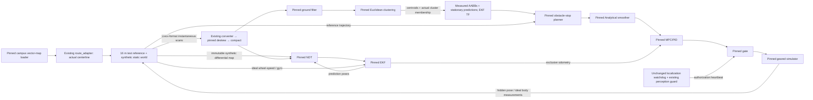

# Experimental campus-vector full-stack demonstration

**Functional integration is implemented; reliable nominal completion is not
established.** The fixed batch passed obstacle 1/2, clear route 2/2, isolated
NDT loss 2/2, and shared-LiDAR loss 2/2. See the
[validation report](../../docs/full_stack/REPORT.md), including the failed attempt.
No commits or pushes were made.

This runs pinned Autoware 1.9.0 conversion/deskew, ground filtering, Euclidean
clustering, NDT, EKF, obstacle-stop planning, Analytical smoothing, MPC/PID, gate
and simulator. Atlas supplies a synthetic scene, geometry/message adapters,
initialization scaffolding and independent evaluation—not replacement estimators,
controllers, clustering or stop planners.

The 16 m reference follows the beginning of the actual loaded campus route
38184 → 23892, starting approximately (41.6384, 68.9965). The LiDAR world and NDT
map are **synthetic geometry constructed in those vector-map coordinates**.
The supplied campus PCD is loaded by the reused map launch but is **not** NDT's
reference. Its registration to the Lanelet map remains unverified. This is not
localization on the real campus point cloud or research recording.

## Data flow



For causal inspection, the planner's **parallel point-cloud stop candidate branch
is disabled** in the new experiment's configuration. It must receive
cluster-derived `PredictedObjects` for an obstacle stop. The real filtered cloud
remains connected and freshness monitored. This changes obstacle representation
selection, not safety thresholds. No obstacle source publishes fabricated
segmented clouds or object results.

The pinned clustering implementation emits centroids/UNKNOWN labels but no usable
shape. `static_objects.py` joins its detected messages with the matching colored
cluster-membership cloud, checks centroids and fits axis-aligned measured bounds.
It transforms these through **EKF TF**, retains the acquisition stamp, and adds a
constant-pose five-second prediction. Existence=1 denotes observed membership,
not a calibrated learned probability. IDs are frame-local, not tracking IDs.
This is a stationary planar-scene adapter, not general object tracking or 3D
shape/orientation estimation. It never reads simulator truth or fixture boxes.

## Build on the existing Atlas workspace

Prerequisites are the already validated ROS Humble dependency caches, original
map files in `/home/marian/Downloads`, and the pinned source checkout. No system
installation, download or upstream edit is performed by this script:

```bash
cd ~/roam/atlas_autoware
bash src/atlas_full_stack_demo/scripts/build_demo.sh
```

The script verifies pinned root/Core/Universe/simulator revisions and clean tracked
sources, builds the unchanged clustering package into `.full_stack_cache` with
one compiler job, refreshes the Atlas localization launch and instrumented
perception guard, and installs this package. It runs the four adapter contract
tests. Existing dependencies come
from `.closed_loop_cache`, `.obstacle_cache`, `.perception_cache` and
`.localization_cache`. Missing caches cause an error; use the corresponding
existing demo build instructions rather than installing packages automatically.
No ephemeral `/tmp` detector installation is needed.

In **each** terminal:

```bash
cd ~/roam/atlas_autoware
source src/atlas_full_stack_demo/scripts/environment.sh
```

This selects ROS domain 86. Run one full-stack instance in that domain; mixing
another `/atlas_loc` graph would invalidate lineage and safety evidence. Existing
localization and obstacle test scripts retain their separate domains/defaults.

## Scheduler and pressure telemetry

The external sampler records Linux scheduler counters for the scene, both safety
watchdogs, NDT, EKF, motion planner, velocity smoother, simulator and perception
containers, controller, and rosbag recorder. It does not subscribe to ROS topics
or alter process priorities. At its default 50 ms interval it writes
`processes.csv`, `system.csv`, and `metadata.json`:

```bash
# Terminal 1: start the existing 15-topic diagnostic recorder first.
RUN=/tmp/atlas_stability_$(date -u +%Y%m%d_%H%M%S)
ros2 run atlas_full_stack_demo record_timing_diagnostics.sh "$RUN"

# Terminal 2: use the exact RUN path printed by Terminal 1.
RUN=/tmp/atlas_stability_YYYYMMDD_HHMMSS
ros2 run atlas_full_stack_demo scheduler_telemetry.py \
  --output "$RUN/scheduler_telemetry"
```

Press Ctrl+C once in each terminal to finalize both recordings. Start telemetry
after the recorder has created `RUN`; both tools refuse to overwrite an existing
output of their own. No full point-cloud topic is recorded by the diagnostic bag.

Every telemetry row includes adjacent `CLOCK_MONOTONIC` and `CLOCK_REALTIME`
nanosecond readings plus their read uncertainty. Rosbag receipt times use the
realtime domain, so correlate a bag timestamp directly with `realtime_ns`; use
`monotonic_ns` for scheduler interval calculations. `metadata.json` records the
initial and final clock pairs, boot ID, kernel, clock tick rate, page size, and
process match rules. `sample_duration_ns` measures sampler work, allowing its
overhead to be audited. A bounded standalone capture is available with
`--duration-sec`, and an otherwise unmatched process can be added as
`--pid LABEL=PID`.

## Bounded, automatically evaluated tests

Each output directory must be fresh. The evaluator starts the full launch,
activates the pinned estimators, sends exactly one biased startup pose, waits for
localization/perception authorization, requests engagement, records evidence, and
shuts the launch down. It does not publish odometry, detections or control commands.

```bash
bash src/atlas_full_stack_demo/scripts/run_test.sh --scenario obstacle \
  --output /tmp/atlas_full_obstacle_review_01
bash src/atlas_full_stack_demo/scripts/run_test.sh --scenario clear \
  --output /tmp/atlas_full_clear_review_01
bash src/atlas_full_stack_demo/scripts/run_test.sh --scenario localization_loss \
  --output /tmp/atlas_full_localization_loss_review_01
```

`localization_loss` deactivates the actual pinned NDT after more than 1 m of travel;
LiDAR and perception continue. Additional scenario `loss` stops the shared LiDAR
source, affecting both localization and perception. Default deadline is 60 s;
accepted bounds are 25–90 s, plus bounded cleanup. These are evaluation deadlines,
not changes to the 300 ms freshness checks.

Repeat with fresh directories and preserve **all** nonzero exits. A successful
single run is not a reliability result. The current obstacle repeat failed on
object-message freshness; do not automatically rearm or select only passing logs.
`validation.json` is authoritative for each attempt. Raw stage JSON files,
`graph.json`, `events.json`, both safety logs and `runtime.log` are retained.

To recheck graph edges, point-count lineage, timing and tracking offline:

```bash
python3 src/atlas_full_stack_demo/scripts/summarize_results.py \
  --root docs/full_stack/validation
```

## Manual launch and operator start

Terminal 1—choose a fresh results path:

```bash
ros2 launch atlas_full_stack_demo full_stack.launch.py \
  obstacle:=true results_dir:=/tmp/atlas_full_manual_review_01
```

`obstacle:=false` selects the clear scene. The simulator initializes at the campus
start but **does not engage automatically**. Terminal 2:

```bash
python3 src/atlas_full_stack_demo/scripts/manual_start.py
```

This bounded operator helper waits for the actual scene, refuses to bootstrap
while moving, activates EKF/NDT, sends one biased seed from the known simulated
start, waits for ten NDT outputs and the combined authorization, then requests
engagement. It waits for actual motion and exits; the launch keeps running. It
publishes no controls or obstacle results. Run it once per launch. After a latch,
preserve logs and restart the experiment; it does not auto-rearm.

These commands expose the underlying processes: `ros2 node list --no-daemon
--spin-time 3`, the launch log and `docs/full_stack/manual/processes.json` show the
simulator/map/perception containers, separate NDT, EKF, MPC, smoother, gate,
planner, two monitors, scene and object adapter. The one launch entry point does
not replace these processes with an Atlas controller/estimator.

## Inspect topics and parameters

Daemon-free inspection avoids the daemon socket restriction encountered in this
tool environment. Allow discovery time; one short CLI discovery query returned
`Node not found` even though a direct parameter-service query succeeded.

```bash
ros2 topic info /atlas_loc/ekf/ekf_odom --verbose --no-daemon --spin-time 3
ros2 topic info /atlas_loc/lidar/compact --verbose --no-daemon --spin-time 3
ros2 topic info /atlas_loc/obstacles/predicted_objects --verbose --no-daemon --spin-time 3
ros2 topic echo /atlas_loc/safety_status --once
ros2 topic echo /atlas_loc/base_safety_status --once
ros2 topic echo /atlas_loc/ekf/ekf_odom --once --field header
ros2 topic echo /atlas_loc/obstacle_trajectory --once --field points
ros2 param get /atlas_loc/motion_velocity_planner \
  obstacle_stop.obstacle_filtering.check_inside.pointcloud --no-daemon --spin-time 3
ros2 param get /atlas_loc/localization_watchdog freshness_sec --no-daemon --spin-time 3
ros2 param get /atlas_loc/obstacle_guard freshness_sec --no-daemon --spin-time 3
```

Expected readbacks: point-cloud stop branch `False`, both freshness limits `0.3`.
The read-only inspector waits for actual services and captures a common scan's
formats, map service provider and parameters:

```bash
python3 src/atlas_full_stack_demo/scripts/capture_contracts.py \
  --output /tmp/atlas_full_contracts_review_01.json
```

Relevant streams, all under `/atlas_loc`:

| Topic | Actual producer / role |
|---|---|
| `sim/output/odometry` | hidden simulator truth; never controller/estimator/planner state |
| `lidar/raw`, `lidar/extended`, `lidar/deskewed`, `lidar/compact` | scene → converter → pinned deskew → compact |
| `ndt/ndt_pose_with_covariance` | accepted pinned NDT absolute measurement |
| `ekf/ekf_odom` | pinned EKF; exclusive MPC odometry |
| `obstacles/pointcloud`, `clusters`, `obstacles/detected_objects` | pinned ground filter and clustering |
| `obstacles/predicted_objects` | measured membership-derived geometry/static prediction adapter |
| `raw_trajectory`, `obstacle_trajectory`, `trajectory` | test reference → pinned stop planner → pinned smoother |
| `control_cmd`, `gated/control_cmd` | pinned MPC/PID → pinned gate → simulator |
| `base_safety_status`, `safety_status` | localization monitor and combined perception authorization |
| `synthetic_map`, `scene_info` | explicit synthetic NDT reference and test geometry metadata |

## RViz

Optional Terminal 3:

```bash
rviz2 -d src/atlas_full_stack_demo/config/full_stack.rviz
```

Fixed frame is `map`. The configuration displays actual campus vector roads,
**synthetic** NDT reference, measured colored cluster points, route/trajectory
geometry and EKF odometry. It does not display the original PCD as an allegedly
aligned localization reference. Point-cloud displays use the appropriate QoS;
the synthetic map and roads are transient local. The configuration is provided;
RViz rendering was not tested in this headless milestone. Recorded driving tests
were headless; visualization can add scheduling load on this VM.

## Expected behavior and failure recognition

In the obstacle case, a fixed 0.8 × 0.6 m block at route distance 10 m is visible
from startup. The vehicle should drive roughly 6 m, stop with about 2 m projected
front-bumper clearance and hold ten seconds. UNKNOWN clusters on the roadside
remain visible in both scenes; a clear route is not an empty LiDAR world. Clear
runs should reach the 16 m goal within 0.15 m and hold ten seconds. Localization
loss should latch and stop, with no indefinite driving on EKF predictions alone.

Failure includes a nonzero evaluator exit, `passed:false`, missing stage outputs,
missing authorization, clearance abort, lost NDT updates, or an unrequested latch.
A stop caused by a freshness latch is **not** a successful planned obstacle stop.
A zero speed at the route endpoint after crossing the obstacle is also a failure;
all such development evidence is retained. Source stamps are not refreshed by
adapters. No ground-truth fallback or automatic latch reset exists.

To pause a manual experiment, Ctrl-C the launch. An explicit simulator pause can
also be requested with `Engage.engage=false`; that is operator/test cleanup, not
evidence of controlled braking. The new object adapter handles context shutdown
separately and still raises runtime errors while ROS is active.

Limitations: ideal body measurements, assumed covariances and virtual co-located
LiDAR, flat synthetic terrain, instantaneous all-visible volumetric point sets,
no ray tracing/occlusion/noise, planar geometry adaptation, no dynamic tracking,
no verified real-PCD registration, and unresolved real-time scheduling/reader
availability gaps. If clustering emits no membership cloud, the adapter withholds
objects rather than fabricating geometry; its freshness monitor can then stop.
This is an experimental vertical slice, not a production autonomous vehicle.
