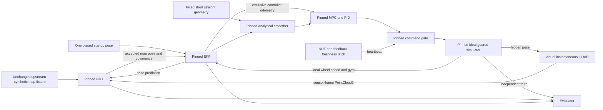

# Synthetic localization-driven closed loop

This isolated milestone runs the **pinned Autoware 1.9.0 NDT, EKF, MPC/PID,
velocity smoother, command gate and simple planning simulator**. It does not
load the campus route, the research recording or the obstacle-stop suite.
**Status: prototype; repeatable nominal completion remains blocked by freshness
interruptions.** One 8 m drive completed; failures are retained.
Read [VALIDATION.md](VALIDATION.md) for executed results and limitations.



The sensor fixture and evaluator may subscribe to simulator truth. Controller,
EKF, NDT, smoother and gate never subscribe to truth odometry. Body-speed,
yaw-rate, steering and acceleration measurements are legitimate ideal simulated
sensors; no absolute truth position/orientation is included in EKF motion input.
The evaluator uses truth for metrics and goal/stop observation only, never to
correct EKF or generate normal commands. No truth fallback exists.

## Contracts and assumptions

All data topics are under `/atlas_loc`; the differential map service is
`/pcd_loader_service`. Use only one instance in ROS domain 83.

| Connection | Contract | Frame and timing |
|---|---|---|
| Sensor → NDT `sensors/points` | `sensor_msgs/PointCloud2`, XYZ float32, 1,261 points | `synthetic_lidar`; original simulator acquisition stamp; up to 10 Hz |
| EKF → NDT `ekf/ekf_pose_with_covariance` | `PoseWithCovarianceStamped` | `map`, 50 Hz predicted current pose |
| NDT → EKF `ndt/ndt_pose_with_covariance` | `PoseWithCovarianceStamped` | `map`, original acquisition stamp, only upstream-accepted matches |
| Motion sensor → EKF `sensors/twist` | `TwistWithCovarianceStamped` | `base_link`, retained acquisition stamp; body forward velocity and yaw rate |
| EKF → controller `ekf/ekf_odom` | `nav_msgs/Odometry` | `map` → `base_link`, nominal 50 Hz |
| Simulator sensors → controller | `SteeringReport`, `AccelWithCovarianceStamped` | body axes; retained acquisition stamps |
| Smoother → controller `trajectory` | Autoware `Trajectory` | `map`; spatial profile, not an absolute schedule |
| Controller → gate → simulator | Autoware `Control` | original combined MPC/PID commands; acceleration/steering limits retained |

The EKF hardcodes `base_link` for its estimated TF/odometry child. Simulator TF
uses `hidden_truth_base`; NDT uses `ndt_base_link`; only EKF publishes estimated
`map → base_link`. Static `base_link → synthetic_lidar` is identity by explicit
virtual sensor design, not a physical Atlas extrinsic. System ROS time is used
throughout; there is no `/clock` or replayed bag in this test.

The map is the unchanged upstream three-face 20 m half-cube, 30,603 points,
translated by (100,100,0). Scans are the upstream 1 m downsampled world surface
transformed by the inverse current simulator pose. This ideal snapshot model
has no occlusion, range noise, beam pattern or rolling acquisition; deskew is
therefore omitted deliberately. Scans publish immediately with their original acquisition stamp. The pinned
`SmartPoseBuffer` accepts a scan newer than its latest EKF prediction within its
existing tolerance; no artificial delay or future seed timestamps are needed.

Simulator setup is (100,100,0), identity orientation, zero speed. EKF receives
**one** initial map pose at (100.3,100.2,0) with covariance; NDT subsequently
receives **only EKF predictions**, never per-scan truth seeds. Motion observations
are ideal noise-free virtual wheel speed and gyro at the body origin, with
assumed standard deviations 0.01 m/s and 0.005 rad/s. These conservative test
covariances are not sensor calibration. Vehicle geometry/dynamics are the same
provisional ideal 1.20 m wheelbase model as the existing demo.

NDT solver/acceptance settings and EKF parameters are the pinned defaults;
only NDT OpenMP thread count is set to one for the VM and loaded-map debug
publication is enabled. The existing controller/gate/vehicle configuration is
reused. The fixed 8 m route supplies 5 m of rearward spline support and a zero endpoint;
the pinned Analytical smoother constructs the bounded velocity/acceleration
profile. No replacement estimator, controller or point-registration code exists.

## Failure handling

`localization_watchdog.py` subclasses the existing simulation feedback watchdog.
It retains every original check and adds accepted NDT source/receipt freshness
with the **same 0.3 s threshold**. EKF output timestamps alone are insufficient:
EKF legitimately predicts onward during pose loss. Startup requires one second
of healthy inputs and at least ten NDT observations before simulator engagement.
After a fault the monitor withholds heartbeat and remains latched; the pinned
gate applies its existing -0.5 m/s² emergency brake after its existing 0.3 s
heartbeat timeout. No automatic rearm or alternative odometry source is used.

Negative startup cases disable NDT or EKF activation. Runtime cases interrupt
scans or deactivate EKF during motion. NDT scans recover after eight seconds
in the scan-drop test, while safety authorization stays latched. Cleanup closes
recording before disengagement, so cleanup cannot count as stopping evidence.

## Reproduction

Prerequisite: the existing `.closed_loop_cache` dependency/demo installs. Run the
existing closed-loop build first if those caches are absent. The build checks
pinned revisions, audits missing localization dependencies, builds serially with
one compiler job, and never installs system packages.

```bash
bash src/atlas_localization_closed_loop_demo/scripts/build_demo.sh
bash src/atlas_localization_closed_loop_demo/scripts/run_test.sh \
  --scenario nominal --output /tmp/atlas_loc_nominal_new
# Separately, using fresh output directories:
bash src/atlas_localization_closed_loop_demo/scripts/run_test.sh \
  --scenario drop_ndt --output /tmp/atlas_loc_drop_ndt_new
# Other scenarios: drop_ekf, no_ndt, no_ekf.
```

Each test has bounded measurement and cleanup time and exits nonzero on a failed
check. It saves graph evidence, source/installed hashes, input scan samples,
truth/NDT/EKF/command CSVs, NDT scores/iterations/latency, safety snapshots and a
JSON verdict. Do not build or run heavy perception tests concurrently with a
driving test. Run all tests serially on the 4 GB VM.

The campus PCD/Lanelet2 alignment remains unverified (regional overlap is not
registration). Success in the synthetic map cannot justify deploying this loop
on the campus map or real recording. Existing demos and unresolved obstacle-stop
regressions remain separate.

To run the complete isolated scenario suite and offline evaluation:

```bash
python3 src/atlas_localization_closed_loop_demo/scripts/run_suite.py \
  --output /tmp/atlas_loc_suite_new
python3 src/atlas_localization_closed_loop_demo/scripts/analyze_results.py \
  /tmp/atlas_loc_suite_new
```

The evaluation interpolates independently recorded truth only for error metrics,
skipping gaps over 40 ms; it never feeds an estimate. The runtime validator uses
nearest truth samples within 25 ms. Both methods and match counts are preserved.
To rerun existing standalone NDT and original closed-loop driving/fault tests,
with `.perception_cache` dependencies already built:

```bash
bash src/atlas_localization_closed_loop_demo/scripts/run_regressions.sh \
  /tmp/atlas_loc_regressions_new
```

This builds the unchanged standalone NDT test in the isolated cache, then runs
the original campus drive and six feedback faults. The obstacle suite is not
invoked. A failure is retained and returns nonzero.

Decision/observation regression tests (source ROS, `.closed_loop_cache/install`
and `.closed_loop_cache/demo_install` first):

```bash
PYTHONDONTWRITEBYTECODE=1 python3 \
  src/atlas_localization_closed_loop_demo/scripts/test_localization_watchdog.py
PYTHONDONTWRITEBYTECODE=1 python3 \
  src/atlas_localization_closed_loop_demo/scripts/test_fault_observation.py
```


An experimental [campus-vector full-stack composition](../atlas_full_stack_demo/README.md)
now reuses this launch through optional Python composition arguments. Its default
localization-only launch remains unchanged. The full-stack obstacle batch passed
1/2; it does not resolve this demo's timing limitations or real-PCD registration.
